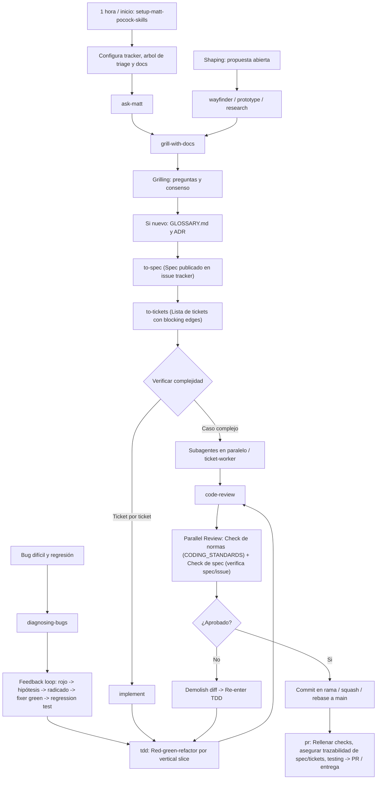

# AGENTS.md

Welcome to **A&B Revival** (Assembly & Battle: The Story in the Space).

## Architecture & Codebase Overview
This project is an unofficial fan tribute, preservation, and modding effort for *Assembly and Battle: The Story in the Space* (2011, Vargames). All original IP, design, and code belong exclusively to **Vargames**.

- `game/`: Holds original and modified `.swf` game binaries (Stage3D 60 FPS 1080p release baseline).
- `A&B-U/`: Unity 6.6 (6000.6.8f1) project target (DOTS, Jobs, PhysicsCore2D) — **Sole Active Production Target**.
- `src/as3/`: Decompiled ActionScript 3 codebase (156 classes) — **Frozen Reference Baseline (Read-Only)** (ADR 0015).
- `metadata/`: Flashpoint Infinity preservation details.
- `assets/`: Artwork, logos, screenshots.
- `graphify-out/`: Persistent knowledge graph generated by `/graphify`.
- `docs/adr/`: Architecture Decision Records.
- `CODING_STANDARDS.md`: Repository coding standards, domain boundaries, and Fowler smells.
- `LICENSE.md`: Intellectual property disclaimer and MIT fan tooling license.

## Agent skills

### Issue tracker
GitHub Issues is the canonical tracker for this repository. See `docs/agents/issue-tracker.md`.

### Triage labels
Canonical five-role triage labels (`needs-triage`, `needs-info`, `ready-for-agent`, `ready-for-human`, `wontfix`). See `docs/agents/triage-labels.md`.

### Domain docs & standards
Single-context domain model with `GLOSSARY.md`, `docs/adr/`, and `CODING_STANDARDS.md`. See `docs/agents/domain.md`.

### Project-local skills
Vendored skills live in `.agents/skills/` (flat, `ab-` prefix) and are committed with provenance in `docs/skills/`. They are additions: the workflow in this file always prevails. Never install skills globally. After changing the tree, run `python scripts/validate_vendored_skills.py`; see `docs/skills/README.md`.

### Codebase navigation (`graphify` & `as3_search`)

A persistent knowledge graph exists at `graphify-out/` (`graph.json`,
`GRAPH_REPORT.md`). Whenever you need context on architecture, module
boundaries, dependencies, or data flows:

- **Query the graph first**: Run `/graphify query "<question>"` (or CLI `graphify query "<question>"`)
  instead of grepping raw files. Use `graphify explain "<concept>"` for nodes and
  `graphify path "<A>" "<B>"` for connection paths. These return scoped subgraphs.
- **Broad overview**: Read `graphify-out/GRAPH_REPORT.md` for God nodes,
  community clusters, and cross-cutting connections.
- **Targeted AS3 Reference Search (`scripts/as3_search.py`)**: When reverse-engineering the frozen Flash baseline (`src/as3/`, ADR 0015), use `python scripts/as3_search.py symbol <name>|callers <method>|class <ClassName>` instead of loading raw classes into context.
- **Surgical reads only**: Orient via knowledge graph, docs, or symbol search before opening raw source files. Never read files one by one to explore structure.
- **Keep graph fresh**: After modifying code or adding documentation, run `graphify update .` (or `/graphify --update`) to keep the graph current.

### Pre-commit guardrails
Pre-commit hooks are version-controlled in `.githooks/` and enforce:
1. `dotnet test "A&B-U/Assets/Scripts/Tests/ABRevival.Tests.csproj"`: Tier 1 fast automated testing gate (ADR 0016) verifying all pure C# domain, simulation, and catalog tests pass with exit code `0`.
2. `scripts/lint_shell_scripts.py --staged`: Static check ensuring all Windows `.bat` scripts enforce safe quoting and ampersand escaping.
3. `scripts/lint_domain_leakage.py --staged`: Static check against domain leakage if legacy Flash AS3 files are touched (frozen baseline, ADR 0015).
4. `scripts/validate_vendored_skills.py`: Checks vendored skill provenance, licenses and lockfile; refuses partially staged skill changes.
Activate via `scripts/install-hooks.bat` (Windows) or `sh scripts/install-hooks.sh` (Unix).

### Project documentation (`docs/` & `CONTEXT.md`)

Consult existing documentation whenever you need domain or project context before planning or implementing changes:

- **`docs/adr/`**: Architecture Decision Records. Surface conflicts explicitly if an approach contradicts an ADR.
- **`docs/agents/`**: Operational guides for agent workflows:
  - `docs/agents/domain.md`: How to consume domain documentation.
  - `docs/agents/issue-tracker.md`: Operating issues and wayfinding maps.
  - `docs/agents/triage-labels.md`: Canonical issue triage roles.

## Coding Standards & Performance Constraints
Consult [`CODING_STANDARDS.md`](CODING_STANDARDS.md) for canonical guidelines:
- **Unity 6 DOTS Performance Rules**: Section 2 (Zero-alloc, Burst concurrency, PhysicsCore2D, Sprite Atlases).
- **Domain Encapsulation**: Section 1 (encapsulation on models, no string matching in UI).
- **Verification Pipeline**: Section 3 (Tier 1 `dotnet test` fast pre-commit gate, Tier 2 headless UTF gate).

### Asset fidelity (mandatory)
Use the **original** Flash art, fonts, audio and UI assets as the baseline. Improvements to layout, UX or art are allowed only with explicit owner approval recorded in the issue/PR; keep the original palette and document what changed. Never substitute fonts. Where no art exists (procedural bullets, VFX), reimplement the behaviour with the original palette and rules. See `docs/adr/0020-original-fonts-and-asset-fidelity.md`. Before laying out any menu section, extract and commit that section's full-page reference symbol (`UI_ChooseFlyAI`, `UI_MakePlayer`, `UI_Shop`, `UI_Help`, `UI_Game`, …) under `docs/assets/reference/` and build against it.

**Font allowlist (only these eight):** SF TransRobotics (symbols 7, 627, 701), Arial (81), `_sans` (2, 478), Times New Roman (595, version plate only), SF Zero Gravity (496, logo only). Quick allowlist: `docs/assets/fonts.md`; full family/usage/licensing table: `docs/assets/reference/README.md#original-font-mapping-adr-0020`. No system or open-substitute font is permitted.

## Engineering Workflow Lifecycle
This repository strictly follows the visual workflow defined in `assets/matt-pocock-workflow.png`:

> [!IMPORTANT]
> **NO IMPLEMENTATION PLAN ARTIFACTS**:
> The issue tracker (GitHub Issues) is the canonical and exclusive home for specs and tracer-bullet tickets.
> Agents MUST NEVER generate `implementation-plan.md` or `task-list.md` artifacts.
> Proceed directly from `/to-tickets` into ticket execution (`/implement` or `ticket-worker`) following the diagram above.

