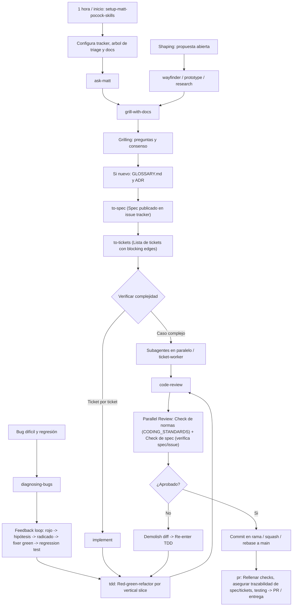

# AGENTS.md

Welcome to **A&B Revival** (Assembly & Battle: The Story in the Space).

## Architecture & Codebase Overview
This project is an unofficial fan tribute, preservation, and modding effort for *Assembly and Battle: The Story in the Space* (2011, Vargames). All original IP, design, and code belong exclusively to **Vargames**.

- `game/`: Holds original and modified `.swf` game binaries.
- `A&B-U/`: Unity 6.6 (6000.6.8f1) project target (DOTS, Jobs, PhysicsCore2D).
- `src/as3/`: Decompiled ActionScript 3 codebase (156 classes) extracted with JPEXS FFDec.
- `metadata/`: Flashpoint Infinity preservation details.
- `assets/`: Artwork, logos, screenshots.
- `graphify-out/`: Persistent knowledge graph generated by `/graphify`.
- `docs/adr/`: Architecture Decision Records.
- `CODING_STANDARDS.md`: Repository coding standards, domain boundaries, and Fowler smells.
- `LICENSE.md`: Intellectual property disclaimer and MIT fan tooling license.

## Agent skills

### Issue tracker
GitHub Issues is the canonical tracker for this repository. See `docs/agents/issue-tracker.md`.

### Triage labels
Canonical five-role triage labels (`needs-triage`, `needs-info`, `ready-for-agent`, `ready-for-human`, `wontfix`). See `docs/agents/triage-labels.md`.

### Domain docs & standards
Single-context domain model with `GLOSSARY.md`, `docs/adr/`, and `CODING_STANDARDS.md`. See `docs/agents/domain.md`.

### Codebase navigation (`graphify` & `as3_search`)

A persistent knowledge graph exists at `graphify-out/` (`graph.json`,
`GRAPH_REPORT.md`). Whenever you need context on architecture, module
boundaries, dependencies, or data flows:

- **Query the graph first**: Run `/graphify query "<question>"` (or CLI `graphify query "<question>"`)
  instead of grepping raw files. Use `graphify explain "<concept>"` for nodes and
  `graphify path "<A>" "<B>"` for connection paths. These return scoped subgraphs.
- **Broad overview**: Read `graphify-out/GRAPH_REPORT.md` for God nodes,
  community clusters, and cross-cutting connections.
- **Targeted Symbol & Callers Search (`as3_search.py`)**:
  To locate symbols without loading oversized decompiled classes into context:
  - `python scripts/as3_search.py symbol <name>`: Find class, method, var, and const definitions.
  - `python scripts/as3_search.py callers <method>`: Find all invocation sites across the codebase.
  - `python scripts/as3_search.py class <ClassName>`: Emit class synopsis with inheritance and public methods.
- **Surgical reads only**: Read raw files only after graphify, as3_search, or docs have
  oriented you, or to edit/debug specific lines. Never read files one by one to
  explore structure. Include this graphify-first rule in every subagent prompt
  involving codebase exploration.
- **Keep graph fresh**: After modifying code or adding documentation, run
  `graphify update .` (or `/graphify --update`) to keep the graph current.

### Pre-commit guardrails
Pre-commit hooks are version-controlled in `.githooks/` and enforce:
1. `scripts/lint_domain_leakage.py --staged`: Static check against domain leakage in UI.
2. `scripts/recompile.bat`: Recompiles SWF to verify zero syntax/compilation errors.
Activate via `scripts/install-hooks.bat` (Windows) or `sh scripts/install-hooks.sh` (Unix).

### Project documentation (`docs/` & `CONTEXT.md`)

Consult existing documentation whenever you need domain or project context
before planning or implementing changes:

- **`docs/adr/`**: Architecture Decision Records. Surface conflicts explicitly
  if an approach contradicts an ADR.
- **`docs/agents/`**: Operational guides for agent workflows:
  - `docs/agents/domain.md`: How to consume domain documentation.
  - `docs/agents/issue-tracker.md`: Operating issues and wayfinding maps.
  - `docs/agents/triage-labels.md`: Canonical issue triage roles.

## Reglas de Rendimiento Unity 6 (CPU Multicore & GPU TBDR)
- **Zero-Alloc:** Prohibido usar `LINQ`, `foreach` sobre listas dinámicas o instanciar clases (`new`) en `Update`, `FixedUpdate` o `LateUpdate`.
- **Concurrencia:** Simula flotas, proyectiles e IA táctica (ADR 0006) con `NativeArray<T>`, `struct` y `IJobParallelFor` decorados con `[BurstCompile]`.
- **Física 2D:** Reemplaza colisiones heredadas por la API multihilo `Unity.U2D.Physics` (`PhysicsCore2D`) basada en structs.
- Agrupa piezas modulares en Sprite Atlases (ASTC en móvil, BC7 en PC), ordena con Z-Buffer y usa `unity_RendererUserValue` para daño o facción por pieza sin romper el batching.
prioriza Vulkan en Android/PC y Metal en iOS.

## Engineering Workflow Lifecycle
This repository strictly follows the visual workflow defined in `assets/matt-pocock-workflow.png`:

> [!IMPORTANT]
> **NO IMPLEMENTATION PLAN ARTIFACTS**:
> The issue tracker (GitHub Issues) is the canonical and exclusive home for specs and tracer-bullet tickets.
> Agents MUST NEVER generate `implementation-plan.md` or `task-list.md` artifacts.
> Proceed directly from `/to-tickets` into ticket execution (`/implement` or `ticket-worker`) following the diagram above.

