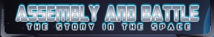
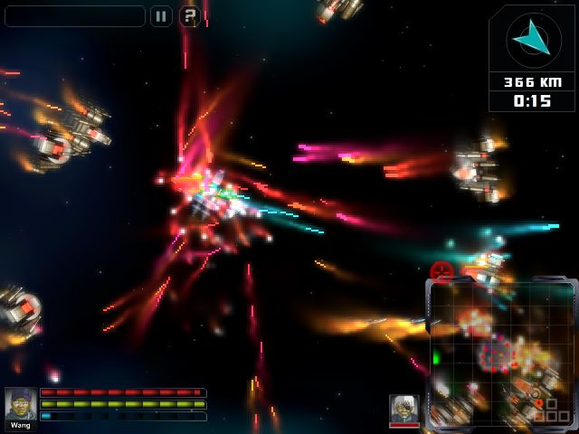

# A&B Revival (Assembly & Battle: The Story in the Space)

> [!IMPORTANT]
> **Fan Tribute & Intellectual Property Notice:**  
> **A&B Revival** is an unofficial, non-commercial fan modification and game preservation project created out of deep admiration and respect for the cult-classic game *Assembly and Battle: The Story in the Space* by **Vargames** (2011).  
> **All original intellectual property, game design, code, artwork, characters, sounds, and lore are the sole and exclusive property of Vargames.** The author and contributors of this repository **do not claim ownership** over any original game code or assets. This repository exists strictly for reverse-engineering, decompiled preservation, quality-of-life enhancements, and community modding research. See [LICENSE.md](LICENSE.md) for full details.

Reverse-engineering, decompilation, enhancement, and modding workspace for **Assembly and Battle: The Story in the Space** (A&B Space) by Vargames (2011).




## Overview
*Assembly and Battle: The Story in the Space* is a cult-classic Flash action space shooter where players assemble customizable spacecraft with modular wings, chassis, engines, weapons, and armor, earning money from battles to upgrade their fleet.

- **Developer**: Vargames
- **Release**: 2011 (Build 111214_2)
- **Engine**: Flash Player 10 / ActionScript 3 (AS3)
- **Resolution**: 640x480 @ 36 FPS
- **Format**: SWF (ZLIB compressed)

## Project Objectives
1. **Decompilation & Source Recovery**: Extract full ActionScript 3 codebase, sprites, sounds, and binary definitions using JPEXS Free Flash Decompiler (FFDec).
2. **Reverse Engineering & Code Mapping**: Use REA (Reverse Engineer Anything) via MCP to map game loops, balance curves, weapon stats, and modular ship attachment slots.
3. **Customization & Modernization**:
   - Balance adjustments and new weapon types.
   - Expanded ship customization options.
   - Quality of life upgrades (framerate, controls, resolution scaling).

## Project Structure
- `game/`: Holds original and modified SWF builds (`a&b_space.swf`).
- `assets/`: Game artwork, logos, and screenshots.
- `metadata/`: Flashpoint Infinity catalog preservation metadata.
- `scripts/`: Automation scripts for asset extraction, decompilation, and recompilation.
- `src/`: Decompiled ActionScript 3 code and extracted assets (generated via JPEXS).

## Quick Start
To launch the game locally:
```cmd
run-game.bat
```
*(Runs with Flashpoint Infinity's standalone Flash Player 32)*.

## Development guardrails

Commits touching ActionScript sources are verified by the version-controlled hook in `.githooks/` (enable once per clone):

```cmd
scripts\install-hooks.bat
```

1. `scripts/lint_domain_leakage.py --staged` — domain boundary lint (see `CODING_STANDARDS.md`).
2. `scripts/recompile.bat` — FFDec compilation check; a broken build blocks the commit.

For token-efficient AS3 navigation use `python scripts/as3_search.py symbol|callers|class <name>`. Full tooling reference: `scripts/README.md`.

## Windows Setup

If you are cloning or working on Windows, enable long path support before cloning to avoid `Filename too long` errors with deep hash-named graphify cache files:

```bat
git config --global core.longpaths true
```

This is required for `git worktree` operations used by parallel development workflows. The `graphify-out/cache/` directory is excluded from version control (`.gitignore`) and regenerates automatically from `graph.json`.

## Attribution & Legal

- **Original Game Creator & Sole Copyright Owner**: **Vargames** (2011).
- **Fan Project Scope**: Fan-made modding, decompiled preservation, and performance modernization (Unity 6.6 port at `A&B-U/`).
- **License**: See [LICENSE.md](LICENSE.md) for full terms. Original assets and IP remain © Vargames; original fan scripts and tooling are provided under the MIT License.


