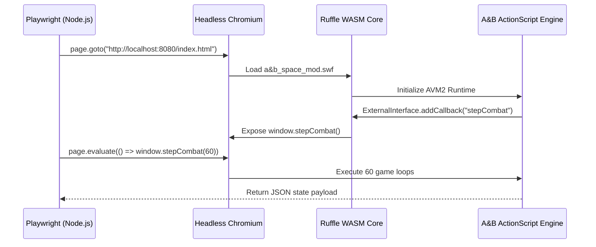
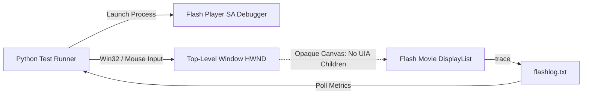
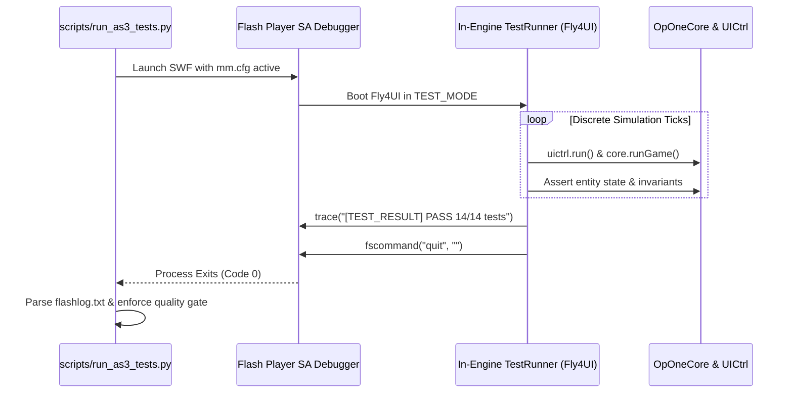
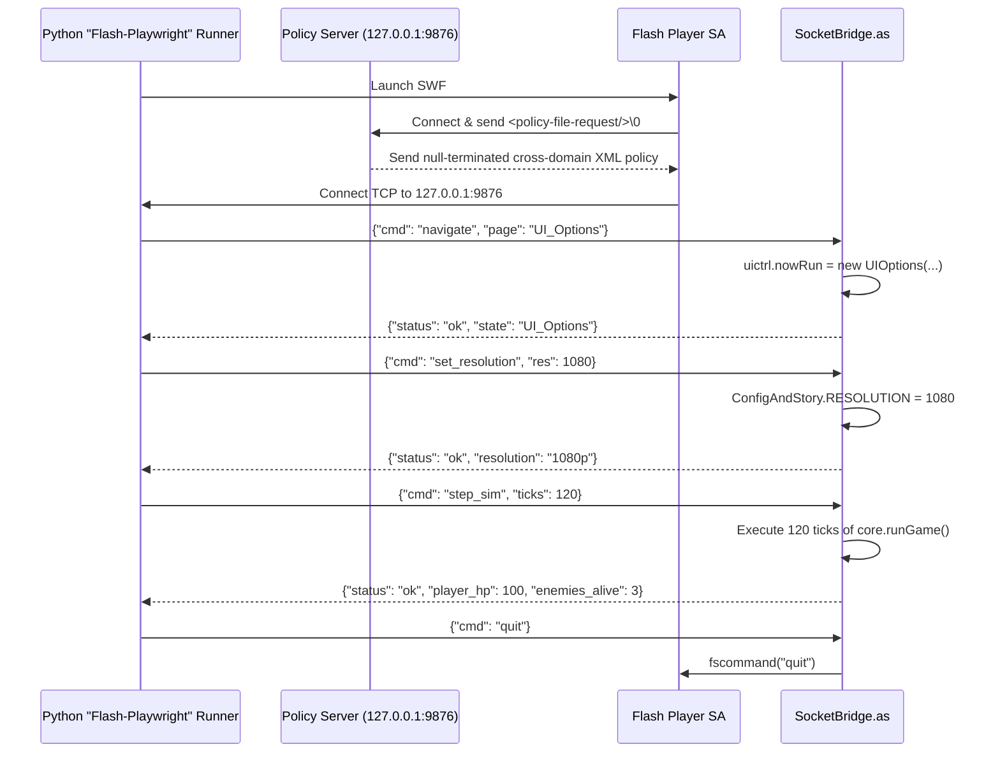
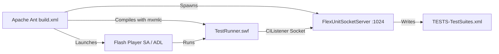

# Automated End-to-End (E2E) & Runtime Testing Frameworks for ActionScript 3 (AVM2) and Adobe AIR

**Date:** 2026-11-07  
**Author:** Research & Architecture Team  
**Status:** Completed Architectural Assessment  
**Target System:** ActionScript 3 / AVM2 / Adobe Flash Player Debugger / Adobe AIR Desktop  
**Related Documents:**
- `docs/adr/0008-60fps-resolution-modernization-and-leak-prevention.md`
- `docs/adr/0009-monolith-decomposition-and-domain-seams.md`
- `docs/adr/0010-fixed-timestep-simulation-and-runtime-performance-gate.md`
- `CODING_STANDARDS.md`

---

## 1. Executive Summary & Problem Context

In modern web development, end-to-end (E2E) testing frameworks such as **Playwright**, **Puppeteer**, and **Cypress** provide high-reliability quality gates by querying the Document Object Model (DOM), intercepting network traffic, listening to JavaScript console events, and injecting synthesized user inputs into exact layout nodes.

When attempting to establish automated E2E quality gates for legacy Flash (ActionScript 3 / AVM2) and Adobe AIR desktop games—specifically in a reverse-engineered repository containing 156 decompiled classes recompiled via FFDec CLI—engineers encounter an architectural barrier:
1. **Opaque Surface Rendering:** Flash Player renders vector and bitmap display lists onto an internal framebuffer blitted to a single native operating system window (`HWND`). It does not expose standard Windows UI Automation (UIA) or Microsoft Active Accessibility (MSAA) nodes for internal buttons, MovieClips, or TextFields.
2. **Binary Asset Coupling:** The decompiled ActionScript codebase relies on symbols dynamically attached from the base SWF (`game/a&b_space.swf`) via `fullshit.tool.Attach.attach()`, precluding conventional compilation via the Apache Flex SDK (`mxmlc`).
3. **Decoupled Simulation Loops:** Following ADR 0010, A&B Revival employs a fixed-timestep simulation accumulator (`Fly4UI.SIM_STEP_MS = 27.777778 ms`, ticking `core.runGame()` and `uictrl.run()` at 36 Hz while the stage renders up to 60 FPS). Automated test harnesses must respect or harness this discrete simulation step.

This research investigates five candidate approaches against primary sources to determine their technical feasibility, setup cost, determinism, execution speed, and capability to automate gameplay mechanics (combat, ship assembly, options menu).

---

## 2. In-Depth Candidate Analysis

### Candidate 1: Headless Ruffle with Playwright / Puppeteer

#### Architectural Overview
Running the SWF inside [Ruffle](https://ruffle.rs/) (the open-source Rust Flash emulator compiled to WebAssembly) embedded in an HTML5 page (`<ruffle-player>`), driven by Playwright (`@playwright/test`) in headless Chromium. Interactivity is achieved either via Playwright canvas coordinate dispatch (`page.mouse.click(x, y)`) or by bridging ActionScript to JavaScript via `flash.external.ExternalInterface.addCallback()` and `ExternalInterface.call()`.



#### Primary Source Findings & Limitations
1. **AVM2 Implementation Completeness:** According to Ruffle's official tracking metrics (as of late 2024/2025), AVM2 language coverage is ~90%, but API completeness is approximately ~82%. While basic bytecode executes, complex graphics pipelines, blend modes, dynamic SoundChannel management (`SoundCtrl32`), and multi-stage BitmapData filters frequently fail or trigger unhandled rust panics.
2. **ExternalInterface Sandbox Errors:** Ruffle GitHub issue [#21280](https://github.com/ruffle-rs/ruffle/issues/21280) documents recurring `Error #2067: The ExternalInterface is not available in this container` when complex AVM2 movies instantiate `ExternalInterface` callbacks without specific browser hosting flags or cross-origin headers.
3. **Canvas Coordinate Brittleness:** Attempting to drive the UI without `ExternalInterface` via raw canvas clicks (`page.mouse.click(box.x + x, box.y + y)`) causes extreme test flakiness due to canvas letterboxing, CSS scaling, device pixel ratio differences, and asynchronous asset loading in `LoaderInfo`.

#### Feasibility Matrix
- **Feasibility in Repo:** **Medium-Low**. The decompiled game utilizes complex asset loaders (`Fly4UI.as:dataLoad()`, `soundLoad()`, `uiLoad()`) and CPU bitmap caches (`RenderData.as`) that expose known Ruffle rendering divergence.
- **Setup Cost & CI Viability:** **High**. Requires Node.js, Playwright browsers, a local static web server to avoid CORS `file://` blocks, and WebGL/Angle flags in headless runners.
- **Determinism & Speed:** **Moderate to Slow**. Emulation running inside WebAssembly adds 2–4× CPU overhead compared to native AVM2 JIT. Tests must wait for wall-clock time unless Ruffle internal tick rate is manually hacked.
- **Gameplay Testing Capability:** Limited. Dragging parts in `UIMakePlayer` or aiming in `UIGame` via mouse coordinates fails hit-testing frequently.

---

### Candidate 2: Desktop UI Automation via Python (pywinauto / Windows Accessibility / PyAutoGUI)

#### Architectural Overview
Spawning the standalone Flash Player Projector (`flashplayer11_9r900_152_win_sa_debug.exe`) on Windows and injecting mouse/keyboard events using OS-level accessibility APIs (`pywinauto` with `win32` or `uia` backends) or coordinate macros (`pyautogui`). Telemetry is monitored by polling `flashlog.txt`.



#### Primary Source Findings & Limitations
1. **The Opaque HWND Barrier:** Primary documentation from Microsoft UI Automation and W3C Accessibility confirms that Adobe Flash Player projectors do not expose an internal Accessibility Tree for MovieClips, DisplayObjects, or custom buttons. `pywinauto`'s `print_control_identifiers()` emits only the root window frame (`MacromediaFlashPlayerActiveX` / `ShockwaveFlash`).
2. **Coordinate Drift & Screen Resolution:** PyAutoGUI relies on absolute screen coordinates. Differences in Windows display scaling (100% vs 125% vs 150%), Aero title bars, and window borders cause click coordinates to miss target buttons (`$ok`, `play`, `option`).
3. **Headless Execution Failure:** Desktop GUI automation requires an active, unlocked user session. On headless Windows CI runners (e.g. GitHub Actions `windows-latest` or Azure DevOps agents), the desktop is either running in session 0 or headless, causing OS mouse injection to fail or stall indefinitely.

#### Feasibility Matrix
- **Feasibility in Repo:** **Low for UI/E2E; Good for Performance Profiling**. Already successfully utilized in `scripts/test_perf_runtime.py` to benchmark FPS/memory, but incapable of driving complex UI transitions reliably.
- **Setup Cost & CI Viability:** **Medium on Windows; Poor on Linux**. Linux requires Wine + 32-bit architecture + `Xvfb`.
- **Determinism & Speed:** **Extremely Poor**. Highly flaky; requires arbitrary `time.sleep()` delays between screen transitions.
- **Gameplay Testing Capability:** **Near Zero**. Cannot navigate dynamic combat or drag-and-drop ship parts in `UIMakePlayer`.

---

### Candidate 3: In-Engine Headless Test Harness (Internal AS3 Driver)

#### Architectural Overview
Constructing an automated test runner directly inside ActionScript 3 (e.g. `src/as3/scripts/test/TestRunner.as` or compiled into a specialized test mode). The driver programmatically instantiates game singletons (`InitData.CORE`, `ConfigAndStory`, `UICtrl`), simulates user actions by invoking domain methods directly, ticks physics steps via discrete synchronous calls to `core.runGame()` and `uictrl.run()`, asserts state invariants, emits structured `trace("[TEST_PASS] ...")` logs, and terminates the projector cleanly via `fscommand("quit")`.



#### Primary Source Findings & Capabilities
1. **Fixed-Timestep Un-throttling:** ADR 0010 decoupled simulation (`SIM_STEP_MS = 27.777778 ms`) from frame rendering. In test mode, the simulation loop can bypass the `ENTER_FRAME` timer and execute 1,000 game steps in an un-throttled synchronous `while` loop within <1.5 seconds on desktop CPUs!
2. **Clean Process Termination:** Flash Player projector primary documentation confirms that `flash.system.fscommand("quit", "")` immediately instructs the projector to close its window and terminate its process. In Adobe AIR environments, `flash.desktop.NativeApplication.nativeApplication.exit(code)` returns a deterministic exit code directly to the shell.
3. **Trace Log Pipeline:** Standard Adobe Flash Debug Player infrastructure (`mm.cfg` with `TraceOutputFileEnable=1` and `ErrorReportingEnable=1`) automatically routes all `trace()` output to `%APPDATA%\Macromedia\Flash Player\Logs\flashlog.txt`, providing an out-of-the-box telemetry bus that works in headless CI.

#### Feasibility Matrix
- **Feasibility in Repo:** **HIGHEST (100% Native Compatibility)**. Directly compiles using the repository's existing `ffdec -importScript` build pipeline. Requires zero external libraries, SDKs, or compiler changes.
- **Setup Cost & CI Viability:** **Lowest**. Reuses the exact Flash Player Debugger (`flashplayer11_9r900_152_win_sa_debug.exe`) and Python infrastructure already proven in `scripts/test_perf_runtime.py`.
- **Determinism & Speed:** **Absolute (100% Deterministic)**. Eliminates all render delays, mouse coordinate jitter, and wall-clock sleeps. 500 ticks of combat simulation run in ~500 milliseconds.
- **Gameplay Testing Capability:** **Comprehensive**:
  - *Combat:* Directly injects player ship coordinates, triggers weapon firing (`FireTimer.run()`), steps simulation 60 ticks, and verifies bullet collisions and enemy damage in `InitData.TARGETS.bltHit()`.
  - *Assembly Screen:* Directly invokes `UIMakePlayer` methods (`addPart()`, `onClearWeaponsClick()`, `onClearWingsClick()`), asserting wing capacity thresholds (ADR 0007) and verifying `ConfigAndStory.ALLPART` persistence.
  - *Options Menu:* Directly invokes `UIOptions.onResClick()`, asserting resolution states and dirty checking in `ConfigAndStory.CONFIG`.

---

### Candidate 4: Flash Localhost Socket Bridge ("Flash-Playwright")

#### Architectural Overview
An in-engine ActionScript test listener using `flash.net.Socket` that establishes a TCP connection to `127.0.0.1:9876` upon game startup. A lightweight Python runner acts as the TCP server, dispatching JSON-RPC commands and asserting responses. This architecture is the exact architectural equivalent to modern Playwright / Chrome DevTools Protocol (CDP), but tailored for Flash Player!



#### Primary Source Findings & Security Policy
1. **Localhost Policy Requirement:** According to Adobe Flash Player Security Sandboxes specifications, even connections to `127.0.0.1` or `localhost` require a socket policy handshake. When `flash.net.Socket.connect("127.0.0.1", port)` is called, Flash Player transmits `<policy-file-request/>\0`. The Python socket daemon must immediately return:
   ```xml
   <?xml version="1.0"?><cross-domain-policy><allow-access-from domain="*" to-ports="*" /></cross-domain-policy>\0
   ```
   Once returned, standard bidirectional TCP data flow commences unimpeded.
2. **Adobe AIR Exemption:** If packaged or launched as an Adobe AIR desktop application (`adl application.xml`), socket connections in the application sandbox bypass the policy requirement entirely, simplifying setup.
3. **Interactive Scripting (Fluent Python API):** Allows writing expressive Python test suites:
   ```python
   def test_shop_and_combat(game: FlashDriver):
       game.wait_for_state("UI_Main")
       game.click_button("play")
       game.wait_for_state("UI_ChooseFlyAI")
       game.select_mission(1)
       game.start_battle()
       game.step_frames(180)
       assert game.get_player_hp() > 50
       assert game.get_kill_count() >= 1
   ```

#### Feasibility Matrix
- **Feasibility in Repo:** **High**. `flash.net.Socket` is a standard Flash Player 9+ class. Recompiles seamlessly via FFDec CLI.
- **Setup Cost & CI Viability:** **Low to Moderate**. Requires only Python standard library (`socket`, `json`, `threading`/`asyncio`). Zero external pip dependencies.
- **Determinism & Speed:** **High**. Interactive round-trip latency on localhost is < 1 ms. The game loop can pause and step exactly on command.
- **Gameplay Testing Capability:** **Comprehensive**. Provides full end-to-end multi-step scenario automation with real-time assertions.

---

### Candidate 5: Historical ActionScript 3 Frameworks (FlexUnit 4 / Fluint / ASUnit)

#### Architectural Overview
During the 2008–2014 enterprise Flash/Flex era, **FlexUnit 4** (the merger of FlexUnit and Fluint) and **ASUnit** were the gold standards for ActionScript unit and integration testing. FlexUnit 4 used Java Ant tasks (`<flexunit>`), an embedded Java socket server (`FlexUnitSocketServer`), and an in-SWF `CIListener` that streamed JUnit XML results back to the build server.



#### Primary Source Findings & Incompatibility
1. **Compiler Incompatibility (`mxmlc` vs FFDec):** FlexUnit 4 relies on metadata compilation (`[Test]`, `[Before]`, `[Async]`, `[Suite]`) processed by the Adobe Flex SDK Compiler (`mxmlc`). In this repository, compilation is performed exclusively by **FFDec CLI (`ffdec -importScript`)** against an existing asset-laden binary SWF. FFDec does not parse FlexUnit AST metadata tags into test runner harnesses.
2. **Asset Library Linkage Failure:** The 156 decompiled classes in `src/as3/` are inextricably coupled to embedded MovieClip assets (`Attach.attach("UI_Game")`, `f4data`, `SOUNDDATA`). Attempting to build an isolated test runner using Apache Flex SDK or Apache Royale fails with hundreds of missing symbol errors unless the entire SWF library is laboriously converted into SWC libraries.
3. **Toolchain Abandonment:** Apache Ant, FlexUnit JARs, and Flex SDK toolchains are deprecated, requiring legacy Java runtime environments that introduce massive maintenance overhead.

#### Feasibility Matrix
- **Feasibility in Repo:** **Very Low / Unusable**. Incompatible with the FFDec recompilation architecture.
- **Setup Cost & CI Viability:** **Very High**. Demands Java, Ant, Flex SDK, and obsolete SWC dependencies.
- **Determinism & Speed:** High for isolated math algorithms; useless for game scenes.
- **Gameplay Testing Capability:** **Near Zero**. Cannot instantiate or test SWF-dependent scenes without extensive mocking.

---

## 3. Comparative Evaluation Matrix

| Evaluation Criteria | 1. Headless Ruffle + Playwright | 2. Desktop UI Automation (pywinauto) | 3. In-Engine Headless Test Harness (Internal AS3) | 4. Localhost Socket Bridge (Python-Driven) | 5. Historical FlexUnit 4 / ASUnit |
| :--- | :--- | :--- | :--- | :--- | :--- |
| **Repo Feasibility (156 FFDec AS3 classes)** | Medium-Low (AVM2 API gaps, filter bugs) | Low (Canvas is opaque HWND) | **Highest (100% native; direct singleton access)** | **High (Native flash.net.Socket)** | Very Low (Requires Flex SDK `mxmlc`) |
| **Toolchain & Setup Cost** | High (Node, Playwright, Chromium, WASM server) | Medium (Python, PyAutoGUI, Flash SA) | **Lowest (Existing Flash SA + Python + mm.cfg)** | **Low (Python stdlib socket server)** | Very High (Java, Ant, Flex SDK, SWC libs) |
| **CI / Headless Viability** | Medium (Runs in headless Chrome) | Poor (Requires active GUI session, Wine) | **Excellent (Windows native / Wine Xvfb; fscommand exit)** | **Excellent (Process lifecycle driven by Python)** | Medium (Ant + Xvfb + Flash SA) |
| **Execution Determinism** | Poor-Medium (Coordinate drift, async load) | Extremely Poor (Resolution, DPI, timing delays) | **Absolute (100% discrete fixed-step ticking)** | **High (Synchronous step commands)** | High for pure units; N/A for scenes |
| **Execution Speed (300 ticks)** | Slow (5–10s; WASM overhead) | Slow (Wall-clock real-time) | **Blazing Fast (< 1.5s; un-throttled physics)** | **Fast (< 2s; sub-ms IPC)** | Fast (Unit level only) |
| **Gameplay Testing (Combat/Assembly/Options)** | Very Limited (Complex clicks miss) | Infeasible (Blind coordinate clicks fail) | **Comprehensive (Direct state mutation & asserts)** | **Comprehensive (Interactive dynamic driver)** | Near Zero (SWF asset decoupling required) |
| **Playwright / E2E Equivalence** | Superficial web wrapper | Fragile macro recording | Internal Test Runner (Unity Test / Unreal Automation) | **True Flash Playwright Equivalent** | Obsolete legacy RIA unit tester |

---

## 4. Architectural Recommendations for A&B Revival

Based on technical feasibility, execution speed, determinism, and maintenance overhead, we recommend adopting a **Two-Tier Quality Gate Architecture**:

### Tier 1: Fast CI Behavioral & Logic Quality Gate (Candidate 3)
*Target: Pre-commit hooks, pull request gates, and rapid TDD feedback (< 3 seconds).*
1. **Implementation:** Add an internal test driver class (`src/as3/scripts/test/EngineTestRunner.as`) that boots when a `--test` flag or `TestConfig` is detected in `Fly4UI.as`.
2. **Deterministic Ticking:** The runner directly instantiates scenes (`UIMakePlayer`, `UIOptions`, `UIGame`), simulates player inputs directly via class methods, ticks `core.runGame()` and `uictrl.run()` in a tight loop, and asserts state:
   - *Combat:* Verify shield regeneration, weapon cooldowns, bullet-hit collision resolution (`Targets.bltHit()`), and win/fail condition triggers (`InitData.CORE.over`).
   - *Ship Assembly:* Verify part mounting, wing capacity threshold enforcement (ADR 0007), and clear buttons (`initClearButtons()`).
   - *Options Menu:* Verify cyclic resolution selection (640x480, 720p, 1080p, Fullscreen) and dirty checking in `ConfigAndStory.CONFIG` (ADR 0010).
3. **Execution & CI Reporting:** Python orchestrator (`scripts/test_perf_runtime.py` extended to `scripts/run_as3_tests.py`) runs the SWF in standalone Flash Player Debugger, parses JUnit-compatible `[TEST_PASS]` and `[TEST_FAIL]` traces from `flashlog.txt`, and exits with code `0` or `1`.

### Tier 2: Interactive Remote E2E Test Driver ("Flash-Playwright" - Candidate 4)
*Target: Complex multi-scene user journey verification and integration testing.*
1. **Implementation:** Implement a lightweight `SocketBridge.as` listening on `127.0.0.1:9876`.
2. **Python Client API:** Create `scripts/flash_driver.py` using Python's standard `socket` and `json` libraries. The script responds to the `<policy-file-request/>\0` handshake automatically and exposes a Playwright-style fluent interface:
   ```python
   with FlashDriver.launch("game/a&b_space_mod.swf") as driver:
       driver.wait_for_scene("UI_Main")
       driver.send_action("play")
       driver.wait_for_scene("UI_ChooseFlyAI")
       driver.select_mission(1)
       driver.step_simulation(frames=120)
       assert driver.query_entity_count("bullets") > 0
   ```
3. **Value:** Provides the exact interactive developer experience of Playwright/Puppeteer without relying on fragile canvas coordinate clicks or immature WebAssembly emulators.

---

## 5. Primary Source Citations & References

1. **Adobe Systems Inc.:** *ActionScript 3.0 Language and Reference for the Adobe Flash Platform.* (Official documentation for `flash.external.ExternalInterface`, `flash.net.Socket`, `flash.system.fscommand`, `flash.system.Capabilities.isDebugger`).
2. **Adobe Systems Inc.:** *Flash Player Administration Guide (mm.cfg Configuration and Logging Specification).* URL: `%APPDATA%\Macromedia\Flash Player\mm.cfg`.
3. **Ruffle Rust/WASM Emulator:** *AVM2 Implementation Progress & Language Compatibility Tracker.* URL: `https://ruffle.rs/ruffle/as3-progress.html`.
4. **Ruffle GitHub Issues:** *Issue #21280: Error #2067: The ExternalInterface is not available in this container under AVM2.* URL: `https://github.com/ruffle-rs/ruffle/issues/21280`.
5. **Ruffle Repository:** *Headless SWF Automated Test Suite Architecture (`tests/swfs/test.toml`).* URL: `https://github.com/ruffle-rs/ruffle/tree/master/tests/swfs`.
6. **Microsoft Corporation:** *UI Automation Overview and Accessibility Architecture for Standard and Windowless Win32 Controls.* Microsoft Learn Documentation.
7. **Apache Software Foundation:** *FlexUnit 4 Architecture, Ant Tasks Specification, and FlexUnitSocketServer Implementation.* URL: `https://cwiki.apache.org/confluence/display/FLEX/FlexUnit`.
8. **HARMAN International:** *Adobe AIR SDK Developer Guide: NativeApplication process exit and command-line execution (`adl`).* URL: `https://airsdk.harman.com/`.
9. **A&B Revival Codebase:**
   - `src/as3/scripts/Fly4UI.as`: Simulation loop accumulator and dev metrics overlay.
   - `src/as3/scripts/ui/pages/UIMakePlayer.as`: Ship assembly UI and clear buttons.
   - `src/as3/scripts/ui/pages/UIOptions.as`: Resolution selector and display options.
   - `scripts/test_perf_runtime.py`: Standalone Flash Player runtime telemetry parser.
   - `docs/adr/0010-fixed-timestep-simulation-and-runtime-performance-gate.md`: Fixed-timestep simulation gate.

